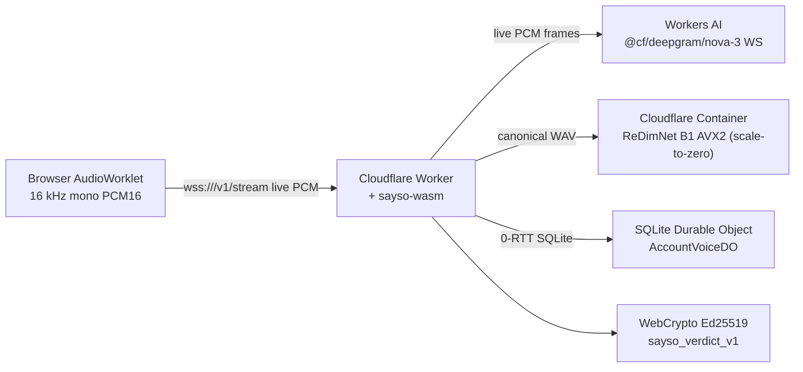

# SaySo

Nothing moves without your say-so.

SaySo is a standalone, zero-Web3, Cloudflare-native spoken-intent authorization library. A user authorizes one exact action—an AI-agent payout, a production deployment, a database reset, or any API call—by saying the canonical sentence aloud.

SaySo checks **who spoke** (ReDimNet B1 192-float speaker template) and **which words were spoken** (spoken-English normalization with strict negation and number guards), then signs a compact 12-field Ed25519 JSON verdict (`sayso_verdict_v1`) bound to `user_id`, `action`, `intent_digest` (SHA-256 of your payload + sentence), and `audio_digest` (single-use canonical WAV SHA-256).

Any backend verifies the verdict with standard WebCrypto Ed25519 via `@sayso/verdict` (zero dependencies).

## Architecture



## Verifying a Verdict in Any Backend (`@sayso/verdict`)

```ts
import { createIntent, verifyVerdict } from '@sayso/verdict';

const { intentDigest } = await createIntent({
  userId: 'alice@acme.com',
  action: 'stripe/payout',
  payload: JSON.stringify({ recipient: 'acct_9182', amount_usd: 45 }),
  sentence: 'Approve payout $45',
});

const result = await verifyVerdict({
  verdictJson,
  signatureB64,
  publicKey: process.env.SAYSO_PUBLIC_KEY_HEX!,
  userId: 'alice@acme.com',
  action: 'stripe/payout',
  intentDigest,
});

if (!result.ok) throw new Error(result.refusal.code);
```

## Repository Layout

- `crates/sayso-wasm` — Pure Rust `wasm32-unknown-unknown` core (spoken-English & currency/number normalization, negation/number guards, `SVT1` speaker templates, `sayso_verdict_v1` builder).
- `crates/speaker-service` — `axum` + `tract-onnx` ReDimNet B1 embedding service + `Dockerfile.cloudflare` (pure scale-to-zero Cloudflare Container).
- `packages/sayso-verdict` — Zero-dependency `@sayso/verdict` TypeScript library (`createIntent`, `verifyVerdict`, `canonicalWav`, `audioDigest`).
- `packages/sayso-client` — `@sayso/client` browser `AudioWorklet` PCM streamer + WebSocket/HTTP SDK.
- `workers/verifier` — Cloudflare Worker (`sayso-verifier`), `AccountVoiceDO`, and `SpeakerContainer`.
- `demo` — Vite + React live streaming demo.

## Quick Start

```bash
pnpm install
pnpm test
pnpm typecheck
```

### Offline Local UI Testing (`SAYSO_DEV_MOCK=true`)

```bash
cp workers/verifier/.dev.vars.example workers/verifier/.dev.vars
pnpm dev:worker   # Terminal 1 (:8787)
pnpm dev:demo     # Terminal 2 (:5179)
```

### Deploy to Cloudflare

```bash
cd workers/verifier
openssl rand -hex 32 | npx wrangler secret put VERDICT_SECRET_KEY_HEX
npx wrangler deploy
```
