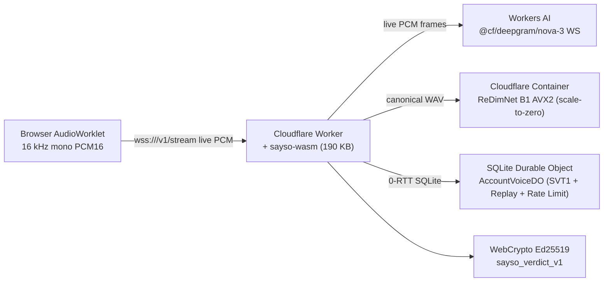

# SaySo

Nothing moves without your say-so.

SaySo is a standalone, zero-Web3, Cloudflare-native spoken-intent authorization library. A user authorizes one exact action—an AI-agent payout, a production deployment, a database reset, or any API call—by saying the canonical sentence aloud.

SaySo checks **who spoke** (ReDimNet B1 192-float speaker template) and **which words were spoken** (spoken-English normalization with strict negation and number guards), then signs a compact 12-field Ed25519 JSON verdict (`sayso_verdict_v1`) bound to `user_id`, `action`, `intent_digest` (SHA-256 of your payload + sentence), and `audio_digest` (single-use canonical WAV SHA-256).

Any backend verifies the verdict with standard WebCrypto Ed25519 via `@seams/sayso-verdict` (zero dependencies).

## Architecture



## Verifying a Verdict & Minting Short-Lived Auth Tokens (`@seams/sayso-verdict`)

Every billable endpoint (`POST /v1/enroll`, `POST /v1/verify`, `GET /v1/stream`) fails closed at the Cloudflare edge unless authorized by a short-lived HMAC token (domain-separated per route) or a server-to-server `Authorization: Bearer <SAYSO_API_KEY>`, followed by per-user sliding-window rate limits in `AccountVoiceDO` before Workers AI or `SpeakerContainer` is invoked.

```ts
import {
  createEnrollmentToken,
  createIntent,
  createVerifyToken,
  MemoryVerdictReplayGuard,
  verifyVerdict,
} from '@seams/sayso-verdict';

// 1. Mint a short-lived enrollment token on your backend for `POST /v1/enroll`:
const enrollmentToken = await createEnrollmentToken({
  userId: 'alice@acme.com',
  secret: process.env.SAYSO_ENROLL_SECRET!,
});

// 2. Mint a short-lived verify/stream token (optionally bound to one exact `intentDigest`)
//    so the browser can open `wss://.../v1/stream?token=...` or call `POST /v1/verify`:
const { intentDigest } = await createIntent({
  userId: 'alice@acme.com',
  action: 'stripe/payout',
  payload: JSON.stringify({ recipient: 'acct_9182', amount_usd: 45 }),
  sentence: 'Approve payout $45',
});
const verifyToken = await createVerifyToken({
  userId: 'alice@acme.com',
  intentDigest,
  secret: process.env.SAYSO_AUTH_SECRET ?? process.env.SAYSO_ENROLL_SECRET!,
});

// 3. Verify the returned signed verdict on your backend (with single-use replay protection):
const replayGuard = new MemoryVerdictReplayGuard(); // or Redis/SQL VerdictReplayGuard

const result = await verifyVerdict({
  verdictJson,
  signatureB64,
  publicKey: process.env.SAYSO_PUBLIC_KEY_HEX!,
  userId: 'alice@acme.com',
  action: 'stripe/payout',
  intentDigest,
  replayGuard,
});

if (!result.ok) throw new Error(result.refusal.code);
```

## Guarded Words (`guardedWordIndexes`)

In a sentence of 4 or more words, SaySo forgives one changed or dropped word, unless that word is a number or a negation. This rule does not protect a name: it accepts "rob" for "bob". An intent can name the word positions that get no forgiveness:

```ts
const { intent, intentDigest, expectedTokens } = await createIntent({
  userId: 'alice@acme.com',
  action: 'bank/transfer',
  payload: JSON.stringify({ to: 'acct_9182', amount_usd: 45 }),
  sentence: 'Send $45 to Bob Miller',
  // expectedTokens: send forty five dollars to bob miller
  guardedWordIndexes: [0, 1, 2, 3, 5, 6], // "send", "forty five dollars" and "bob miller"
});
```

- The indexes are positions in `expectedTokens`. They must be strictly ascending.
- A changed or dropped word at a guarded position refuses with `words`. Here "send forty five dollars to rob miller" and "lend forty five dollars to bob miller" refuse. Only "to" can still be misheard.
- Guard each word whose change can change the action: the values and also the verb. On the STT-1 sentences with perfect transcripts, guards on the values alone let 484 of 3,742 near misses pass, such as "lend" for "send" and "remove" for "add" ([bench/stt1](bench/stt1)). With every word guarded, none passed.
- `intent_digest` covers the list. A verdict for the same sentence without the guards has a different digest, so `verifyVerdict({ intentDigest })` refuses it.
- An intent that sayso-wasm does not accept, such as one with a list that is out of order, gets a signed `unsupported` refusal before a speech or speaker model runs.

### Intent digest

```text
intent_digest = SHA-256("sayso:intent:v1\0" || lp(user_id) || lp(action) || payload_sha256
                        || lp(canonical_sentence) || guards)
lp(b)         = u32_le(len(b)) || b
guards        = lp(guarded_word_indexes), one byte for each index; empty if the intent has none
```

The `guards` block is optional and the domain stays `v1`. The other choice was a `v2` domain that always has the block. The reasons for `v1`:

- An intent with no guarded words keeps its digest. Clients and verify tokens from before guarded words still match, so the Worker and its clients do not have to change at the same time.
- Each preimage still reads in one way: the sentence has a length prefix, and the block is never an empty list.
- It fails closed. A Worker from before guarded words refuses an intent that has `guarded_word_indexes`, because it refuses unknown intent fields.

A transcript-only intent (below) uses the domain `"sayso:intent:transcript:v1\0"` in place of `"sayso:intent:v1\0"`, with no `guards` block.

## Transcript-Only Intents (`transcriptOnly`)

Word matching suits a fixed sentence. It does not suit a sentence with free names and amounts: a transcriber writes "Send 8,888 NEAR to eric.testnet." for "send eight thousand eight hundred eighty eight near to erik dot testnet". On the STT-1 transaction sentences, SaySo's word check accepted 4.2% of correct readings ([bench/stt1](bench/stt1)). For such a request, let your own parser decide the words:

```ts
const { intent, intentDigest } = await createIntent({ userId, action, payload, sentence, transcriptOnly: true });
// ... verify, then:
const result = await verifyVerdict({ verdictJson, signatureB64, publicKey, userId, action, intentDigest });
if (result.ok) parseMyRequest(result.verdict.heard); // "Send 8,888 NEAR to erik.testnet."
```

- SaySo checks the speaker, the audio and the single use of the recording, but not the words. An accepted verdict carries the transcript as written in `heard`, with its case and punctuation, cut to 200 bytes.
- Your parser must refuse a transcript that does not say the request. An empty transcript refuses with `words`.
- The intent digest has its own domain, so a transcript-only verdict never matches an intent whose words SaySo checks.
- The stream (`/v1/stream`) does not close early on a word match for such an intent; it closes on the end of speech.
- An intent cannot have both `transcriptOnly` and `guardedWordIndexes`.

## Quick Start

```bash
pnpm install
pnpm test
pnpm typecheck
```

### One-Command Offline Local UI Testing (`SAYSO_DEV_MOCK=true`)

```bash
cp workers/verifier/.dev.vars.example workers/verifier/.dev.vars
pnpm dev   # Launches Worker (:8787, local mock mode) + Demo (:5179) together
```

### Deploy to Cloudflare

```bash
cd workers/verifier
# 1. Verdict Ed25519 signing seed (required; Worker fails closed in production if unset):
openssl rand -hex 32 | npx wrangler secret put VERDICT_SECRET_KEY_HEX
# 2. HMAC auth secret for short-lived browser enroll + verify/stream tokens
#    (optionally set a separate SAYSO_AUTH_SECRET for verify/stream; domain prefixes isolate both):
openssl rand -hex 32 | npx wrangler secret put SAYSO_ENROLL_SECRET
# (Optional) Server-to-server Bearer API key for proxied backend calls:
openssl rand -hex 32 | npx wrangler secret put SAYSO_API_KEY
# 3. Deploy Worker + SQLite AccountVoiceDO + scale-to-zero SpeakerContainer:
npx wrangler deploy
```

> To host `redimnet-b1.onnx` in your own R2 bucket or GitHub Release, override `MODEL_URL` in [`crates/speaker-service/Dockerfile`](crates/speaker-service/Dockerfile); the SHA-256 pin (`e04dd7a6a1e23fc7b89e47682ea9d0a3946cf7bc59d07922c3db3efc52ae4269`) is verified at both image build and container boot.

## Packages and Releases

| Package                                                 | npm                                                                          |
| ------------------------------------------------------- | ---------------------------------------------------------------------------- |
| [`@seams/sayso-verdict`](packages/sayso-verdict)        | [npmjs.com/package/@seams/sayso-verdict](https://www.npmjs.com/package/@seams/sayso-verdict) |
| [`@seams/sayso-client`](packages/sayso-client)          | [npmjs.com/package/@seams/sayso-client](https://www.npmjs.com/package/@seams/sayso-client)   |

Both packages have one exact version, and `@seams/sayso-client` depends on the same version of `@seams/sayso-verdict`. To release:

1. Set the new version in both `package.json` files, and commit it on `main`.
2. Run the workflow **Release the SaySo packages** (`.github/workflows/release.yml`) with that version. It tests, packs and publishes both packages with npm provenance. A version that is on npm already is skipped, so a failed run can run again.

The workflow publishes through npm trusted publishing, with no npm token. For a new package name, run `scripts/npm-trust.sh` one time first, logged in to npm. npm trusts a workflow only for a package that exists, so the script publishes a placeholder `0.0.0-stage` (dist-tag `stage`) for a name that is not on npm yet.
