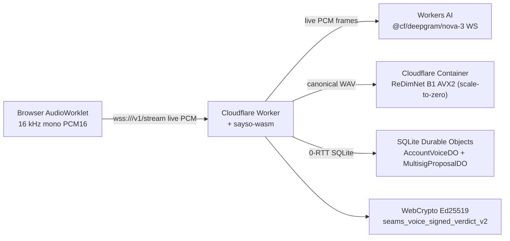

# SaySo

Nothing moves without your say-so.

SaySo is the low-latency Cloudflare-native implementation of spoken-intent authorization. A person authorizes one exact action—an AI-agent payment, a deployment, a NEAR transfer, or a multisig proposal—by speaking the canonical sentence aloud.

SaySo verifies **who spoke** (ReDimNet B1 192-float voice template) and **which words were spoken** (`spoken-intent` grammar + confusion set), then signs a 13-field `seams_voice_signed_verdict_v2` Ed25519 verdict bound to both `request_digest` and `audio_digest`. Every verdict is 100% wire-compatible with `@seams/voice-verdict`, `@seams/wallet`, and existing on-chain NEAR contracts (`notes`, `pm-notes`, `voice-multisig`).

## Architecture (`~300 ms` Post-Speech Wait)



### Key Design Choices

1. **Zero per-call WASM cold load:** `crates/sayso-wasm` compiles `spoken-intent`, `words`, `audio`, `embedding`, `policy`, and `verdict` to a standalone `wasm32-unknown-unknown` module (`~336 KB`). `workerd` keeps the compiled module warm across requests.
2. **Token-matched `200 ms` early close with negation guard:** Because `spoken-intent` renders the exact expected token list before speech begins, the Worker monitors live `@cf/deepgram/nova-3` tokens and schedules commit `200 ms` after all expected tokens match. If a trailing word (such as `"not"`) arrives inside that window, early-close cancels immediately and refuses with `words`.
3. **Deterministic frame-indexed `audio_digest`:** When the Worker commits at `sampleCount = N`, it builds the canonical 44-byte WAV over `samples[0..N]` and returns `sampleCount` with the signed verdict. `@seams/sayso-client` builds the byte-identical WAV from its local PCM buffer so `checkVerdict` verifies both `requestDigest` and `audioDigest` locally.
4. **Atomic SQLite Durable Objects:** `AccountVoiceDO` stores 808-byte `SVT1` templates and enforces single-use `audio_digest` replay protection in one synchronous SQLite transaction. `MultisigProposalDO` stores proposal openings, `MAX_TRIES = 3` counters, and signer templates for zero-hop `same_speaker` enforcement.
5. **Pure scale-to-zero `SpeakerContainer`:** Configured in `workers/verifier/wrangler.jsonc` with no warm keepalive cron (`sleepAfter = "3m"`).

## Quick Start

```bash
pnpm install
pnpm test
pnpm typecheck
```

### Offline Local UI Testing (`SAYSO_DEV_MOCK=true`)

For offline development without Docker or remote Cloudflare AI bindings:

```bash
cp workers/verifier/.dev.vars.example workers/verifier/.dev.vars
# Terminal 1: Start Worker locally on :8787 (verdicts tagged "sayso/0.1.0+mock")
pnpm dev:worker
# Terminal 2: Start Vite demo on :5179
pnpm dev:demo
```

### Deploy to Cloudflare

```bash
cd workers/verifier
openssl rand -hex 32 | npx wrangler secret put VERDICT_SECRET_KEY_HEX
npx wrangler deploy
```
